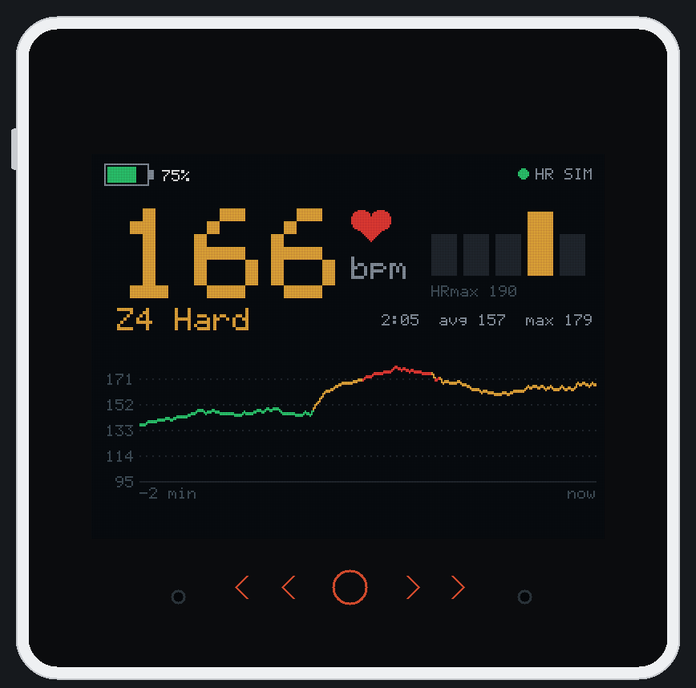
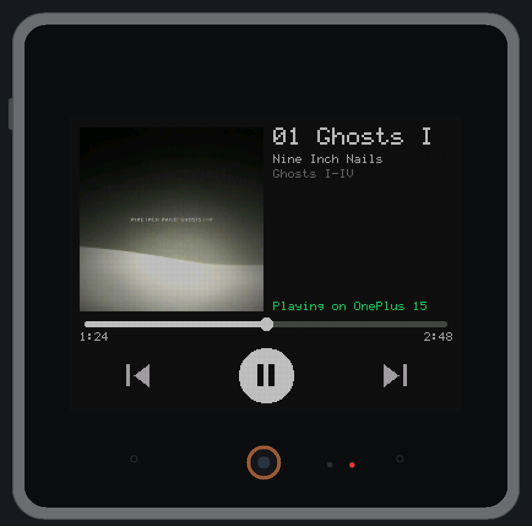
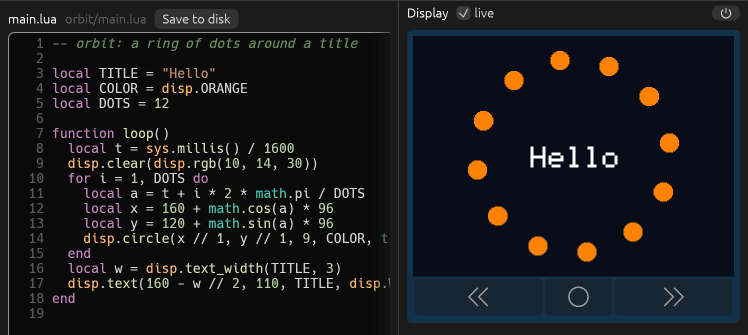

<h1 align="center">luaboard</h1>

<p align="center">
  Write Lua 5.4 apps for the <a href="https://m5stack.com">M5Stack</a> CoreS3, CoreS3 Lite and CoreS3 SE, with a desktop simulator and studio.
</p>

<p align="center">
  <a href="https://github.com/veikkos/luaboard/actions/workflows/ci.yml"></a>
  <a href="LICENSE"></a>
  <a href="https://www.lua.org"></a>
  
</p>

<p align="center">
  
  
</p>

luaboard is a work in progress. For now it runs only in the simulator, and
the release for the real board is near. Things change and break without
notice.

- Hot reload: save and the app restarts, on the board or in the simulator.
- Cross-platform [simulator](platform/sim/README.md),
  [studio and CLI](pc-tool/README.md) for macOS, Windows and Linux.
- USB or encrypted Wi-Fi link to the studio and CLI.
- Firmware updates over Wi-Fi, offered by the device.
- Apps from the [marketplace](https://github.com/veikkos/luaboard-marketplace),
  from Spotify and Google Calendar to electricity prices and Home Assistant,
  installed and updated on the board.
- Graphics, touch, sound, sensors, a serial port, PWM, an SD card, Bluetooth
  LE, TLS, MQTT, HTTP and OAuth built in.



## Quick start

The quickest way in is a [release](https://github.com/veikkos/luaboard/releases/latest):
an archive for macOS, Windows or Linux with the studio, the command-line tool
and the simulator, and `luaboard-m5stack-cores3.bin` to flash a
board (`luaboard flash`). Unpack it and run `luaboard-studio` or `esp32-sim`.
On macOS the downloaded files are quarantined, so run
`xattr -dr com.apple.quarantine <folder>` on the unpacked folder once. A
device with Wi-Fi then offers later releases itself, see
[docs/DEVICE.md](docs/DEVICE.md#firmware-updates).

To build from source instead, clone with
`git clone --recursive https://github.com/veikkos/luaboard` (`marketplace/` is
the marketplace as a submodule, `git submodule update --init` fetches it in an
existing clone). The simulator and the tools build with CMake
on macOS, Windows and Linux. SDL2 and mbedTLS come from the system when it
has them, otherwise the build downloads and builds them itself.

macOS (Xcode command line tools and Homebrew):

```sh
brew install cmake ninja sdl2 mbedtls rustup
$(brew --prefix rustup)/bin/rustup default stable   # rustup is keg-only
cmake --preset default                 # configure (build/)
cmake --build --preset default --target tool   # studio and CLI
cmake --build --preset default --target run    # simulator window, serial port at /tmp/esp32-sim
pc-tool/target/release/luaboard-studio marketplace/dashboard   # in another terminal
```

Windows (Visual Studio 2022 with the C++ workload, CMake 3.25 or newer:
Visual Studio's own is on the PATH in its Developer prompt, and
[rustup](https://rustup.rs)):

```sh
cmake --preset vs
cmake --build --preset vs --target tool
cmake --build --preset vs --target run         # serial port \\.\pipe\esp32-sim
```

Linux: `apt install cmake ninja-build libsdl2-dev`, then as on macOS.

Target options are environment variables for that one command, such as
`MODEL=cores3 cmake --build --preset default --target run` (PowerShell:
`$env:MODEL="cores3"` first). They are listed at the top of
[CMakeLists.txt](CMakeLists.txt).

The CLI is built to `pc-tool/target/release/luaboard`:

```sh
export PATH="$PWD/pc-tool/target/release:$PATH"
luaboard install marketplace/clock --run
luaboard eval 'sys.battery()'
```

For the real device, see [app/idf/README.md](app/idf/README.md).

## Apps

An app is a folder of Lua files starting at `main.lua`. Other Lua files are
modules for `require`. Pictures (`.jpg`) and sounds (`.wav`) in the folder go
along too, for `asset("logo.jpg")`. An optional `app.json` sets the menu
title and info:

```json
{ "title": "Clock", "description": "Digital or analog", "version": "1.0.0", "author": "You", "license": "MIT", "lua_api": 1 }
```

`lua_api` is the [Lua API version](docs/LUA_API.md#api-version) the app was
written for. A firmware too old for it says so instead of starting it.

Uploaded apps stay in RAM until restart, installed apps live in flash. A
`secrets.env` in the folder (gitignored) is stored as the app's secrets.

Apps sit side by side in the home menu, each sandboxed with its own secrets,
so a new one can't reach the others' logins ([SECURITY.md](SECURITY.md)).

Using the device (the menu, the buttons, settings, crashes and safe mode) is
described in [docs/DEVICE.md](docs/DEVICE.md).

## Writing scripts

```lua
local ui = require("widgets")           -- widgets.lua in the app folder

function loop(dt)                       -- called at sys.rate() Hz, default 30
  disp.clear(disp.NAVY)
  disp.text(10, 10, "KNOB " .. adc.read_mv(adc.PORTB_IN) .. " mV", disp.WHITE, 2)
  ui.bar(10, 40, 300, 16, adc.read(adc.PORTB_IN) / adc.MAX, disp.ORANGE)
  local x, y = touch.read()
  if x then disp.circle(x, y, 12, disp.YELLOW, true) end
end
```

Scripts are sandboxed: 4 MiB heap, 1 s watchdog per call, no `io`/`os`.
Each run starts clean. Errors stop the script and show file, line and message
on the device and in the studio.

Networking uses non-blocking sockets with TLS, plus built-in `mqtt`, `http`,
`json` and `oauth` libraries. `task()` and `sleep()` run network code as
coroutines:

```lua
local mqtt = require("mqtt")
task(function()
  local c = assert(mqtt.connect("mqtt://192.168.1.10", { client_id = "weather-1" }))
  while c.connected do
    c:publish("weather-1/knob", adc.read(adc.PORTB_IN), { qos = 1 })
    sleep(10000)
  end
end)
```

Full reference: [docs/LUA_API.md](docs/LUA_API.md).

## Wi-Fi

Set the network once over USB (`luaboard wifi set "SSID" "password"` or
Wi-Fi... in the studio). The device then appears as `luaboard.local` and
speaks the same protocol over TCP port 3333. To use it over Wi-Fi, pair your
computer with it over USB. An unpaired device takes no commands over Wi-Fi.
See [docs/PROTOCOL.md](docs/PROTOCOL.md#wi-fi-link).
The simulator started by the `run` target is already on its own network
("Simulator"), so it needs no setup.

Paired, the board doesn't need to be within reach. The studio's Display
panel mirrors its screen and takes clicks, drags and keys as touches and
button presses, so you can write, run and try an app on a device across the
house. The CLI can do the same, for example `luaboard touch 160 120` or
`luaboard touch B --hold 800`.

Firmware updates from a computer go over the same link, USB or Wi-Fi
([pc-tool/README.md](pc-tool/README.md#firmware-updates)).

## Development

The build targets are listed at the top of [CMakeLists.txt](CMakeLists.txt).
Tests, the pre-push hook and how to contribute are in
[CONTRIBUTING.md](CONTRIBUTING.md). The design is described in
[docs/ARCHITECTURE.md](docs/ARCHITECTURE.md) and the wire protocol in
[docs/PROTOCOL.md](docs/PROTOCOL.md).

## License

MIT, see [LICENSE](LICENSE). Third-party components are listed in
[THIRD_PARTY_NOTICES.md](THIRD_PARTY_NOTICES.md).

luaboard is an independent project, not affiliated with or endorsed by
M5Stack or by the makers of the services and products the apps work with.
M5Stack and CoreS3 are trademarks of M5Stack Technology Co., Ltd. Spotify,
Google Calendar and Home Assistant belong to their owners.
