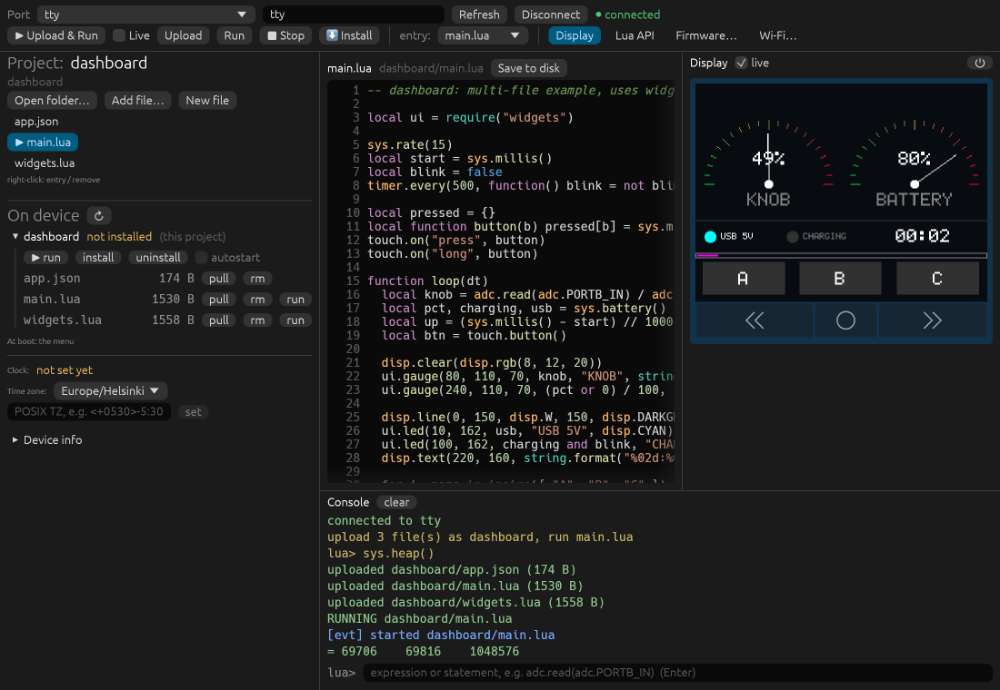

# PC tools

Two binaries, built with the `tool` CMake target (or `cargo build --release` here),
on macOS, Windows and Linux:

- `target/release/luaboard-studio`: GUI
- `target/release/luaboard`: CLI

Both use the client library in `src/`, whose modules are listed in
[docs/ARCHITECTURE.md](../docs/ARCHITECTURE.md).



## Studio

`luaboard-studio [--port PORT] [folder or files]`, or the `studio` CMake target. Without a port it
connects to the first running simulator (`/tmp/esp32-sim`, Windows `\\.\pipe\esp32-sim`, more
[side by side](../platform/sim/README.md#serial-link)).

- Port list: serial ports, the simulator, and Wi-Fi devices found via mDNS.
  Picking one connects, and it reconnects automatically when the link
  drops. The list is refreshed every 2 s, so a simulator started later
  shows up.
- Project: a folder is an app. Upload & Run puts it in RAM, Install writes it
  to flash. Both say when the app keeps secrets on the device that the new
  code can read. With Live on, it is uploaded and run again 0.6 s after the
  code last changed, typed in the studio or saved from another editor. Code
  with a syntax error waits for the next change.
- Files saved from another editor are reloaded, unless they have edits in
  the studio not saved yet (those are kept).
- Editor: Lua syntax checking with the firmware's own parser. Runtime errors
  are marked on the failing line. Cmd/Ctrl+Enter runs, Cmd/Ctrl+S saves.
- On device: installed and uploaded apps (run, install, uninstall, autostart,
  and per-file pull/remove/run) and the device clock and time zone.
- Console: `print()` output, events, and a Lua REPL.
- Display: the device screen, live, and remote control. Click and drag on it
  to touch. The A/B/C strip under it is the touch buttons. With the display
  focused (click it), the keys are the simulator window's: Left or Up, Enter
  and Right or Down (or A, B, C) hold A, B and C as long as the key is down,
  and P presses the power key. Works over Wi-Fi too. Only changed
  frames are sent, and it polls faster for a moment after you touch. Hide the
  panel with the Display toggle: then nothing is polled or sent.
- Lua API: opens the reference (docs/LUA_API.md on GitHub) in the browser.
- Firmware...: flash a `.bin` over USB. Starting the studio with a `.bin`
  opens this window.
- Wi-Fi...: network status, set or forget the network, pair this computer
  for Wi-Fi (over USB), switch this session to Wi-Fi.
- Browser login: when a script calls `browser.login()` (OAuth), the studio
  opens the login page and passes the result to the device. It never sees
  passwords or tokens.

## CLI

```sh
E=pc-tool/target/release/luaboard     # port: -p, $LUABOARD_PORT, or the first simulator
$E install marketplace/dashboard --run
$E put marketplace/paint/main.lua --run main.lua
$E eval 'adc.read(adc.PORTB_IN), sys.battery()'
$E monitor
$E -p /dev/cu.usbmodem1101 info
$E -p tcp://192.168.1.23:3333 ls
```

| Command | Description |
|---|---|
| `ports` | Serial ports and network devices |
| `ping`, `info` | Reachability. Firmware, storage, heap, Wi-Fi, pairing state |
| `crash [--elf FILE]` | The last crash: its cause and stack trace, with functions and lines from the build's ELF (default `build/idf-<board>/luaboard.elf`, if it's that very build) and ESP-IDF's `addr2line`. The studio shows it in its console when it connects after a crash |
| `apps` | Apps on the device |
| `install DIR [--app NAME] [--run] [--autorun]` | Install a folder as an app, or write an uploaded app (DIR = its name) to flash |
| `uninstall APP` | Delete an app and its secrets |
| `ls`, `put FILES... [--app NAME] [--run FILE] [--save]`, `get NAME [-o FILE]`, `rm NAME` | Files, named `<app>/<file>`. `put` uploads to RAM |
| `check FILES...` | Syntax-check scripts locally |
| `run APP[/FILE.lua]`, `stop` | Start or stop a script |
| `save`, `format`, `autorun [APP\|off]` | Install all RAM uploads. Delete all apps and secrets. Set the boot app |
| `screenshot FILE.ppm` | Save the screen |
| `touch X Y`, `touch A\|B\|C`, `touch power` `[--hold MS]` | Touch the device from here: a point on the screen, a touch button, or the power key. `--hold 800` is a long press |
| `eval CODE` | Run Lua and print the result |
| `monitor [--secs N]` | Stream output and events |
| `raw` | Pass bytes between stdin/stdout and the serial link, unchanged (protocol debugging, and the tests use it) |
| `wifi`, `wifi set SSID [PASSWORD]`, `wifi off` | Wi-Fi network |
| `time [--sync]`, `tz [ZONE]`, `tz --list` | Clock and time zone (name or POSIX TZ) |
| `pair [--new]`, `pair off` | Pair this computer for Wi-Fi over USB: saves the device's key in this computer's [key file](../docs/PROTOCOL.md#wi-fi-link). `--new` makes a new key (other computers must pair again), `off` unpairs. Without arguments over Wi-Fi: the status |
| `browser [--wait N] [--no-open]` | Complete a script's browser login |
| `secrets`, `secrets set APP NAME VALUE`, `secrets rm APP [NAME]` | Per-app secrets (values never shown) |
| `secrets push FOLDER` | Store the `secrets.env` of an app folder, or of every app in a folder of apps (`marketplace`), for the apps the device has. The others are skipped, and its other secrets stay |
| `update FILE [--check]` | Update the firmware over the device's link (USB, Wi-Fi or the simulator), see below. Apps and settings stay |
| `flash FILE [--check]` | Flash firmware over USB with the chip's bootloader (apps and settings stay): for a first install or a device whose firmware doesn't answer |
| `sim-ctl LINES... [--control PORT]` | Send control lines to a running simulator (`button=B`, `advance=60000`), see [the simulator's README](../platform/sim/README.md#control-channel) |
| `erase [--yes]` | Erase all data from the flash over USB: apps, secrets, Wi-Fi, pairing, settings. The firmware stays. Use before giving the device away |

`put` and `install` syntax-check first (`--no-check` skips) and also upload a
project's `secrets.env`. Global options: `-p/--port`, `-b/--baud` (115200), `--linger SECS` (how long to keep showing the device's output after
starting a script, default 0.3, or after a browser login, default 1.5, and the tests use 0).

### Firmware updates

`update` sends a firmware image with the `OTA` command
([protocol](../docs/PROTOCOL.md#firmware-update-ota)). The device writes it into
its free app slot and reboots into it, and `update` checks it came back
running the new firmware. If the new firmware keeps crashing, the device goes
back to the old one, which is kept in the other slot.

```sh
$E -p /dev/cu.usbmodem1101 update build/luaboard-m5stack-cores3.bin   # the fw target
$E -p tcp://luaboard.local:3333 update build/luaboard-m5stack-cores3.bin
$E update build/m5stack-cores3/esp32-sim                              # a running simulator (Windows: .exe)
```

A device takes the merged `.bin` from the `fw` target (or the app-only
`build/idf-*/luaboard.bin`). A simulator takes a simulator executable for its
board, and reboots into it. The studio does the same from its Firmware window
(the Update button), next to flashing with the bootloader over USB.

## Test hooks

Environment variables for scripted runs (the tests use only
`LUABOARD_BROWSER`, with the CLI):

| Variable | Effect |
|---|---|
| `LUABOARD_STUDIO_SCREENSHOT=out.ppm` | Upload and run the project, save a window screenshot, exit |
| `LUABOARD_STUDIO_DEMO=steps.txt`, `LUABOARD_STUDIO_RECORD=dir` | Run the project with Live update, type the edits in steps.txt into the open file, and save a frame of the window every 100 ms (the README's GIF, see `demo.rs`) |
| `LUABOARD_STUDIO_OPEN=wifi\|firmware` | Open that window at startup |
| `LUABOARD_STUDIO_SELECT_PORT=...` | Pick a port once connected |
| `LUABOARD_STUDIO_AUTO_LOGIN=1` | Start a script's browser login without asking |
| `LUABOARD_BROWSER="curl -sL"` | Command that opens login URLs (URL appended), CLI and studio |
