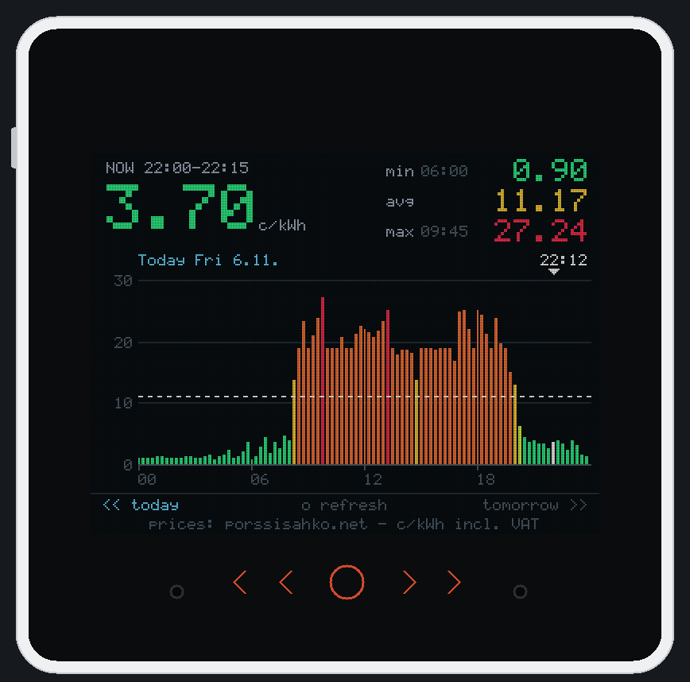
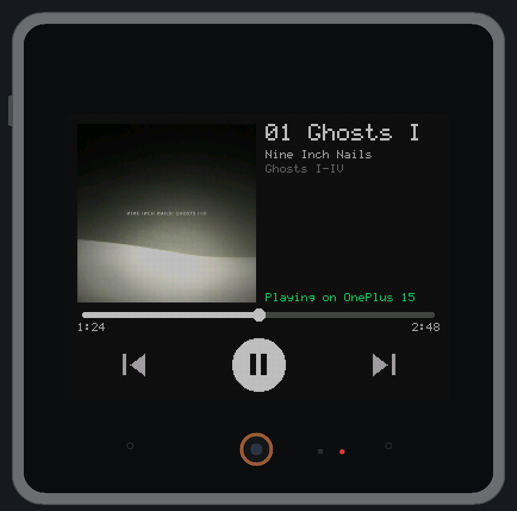

# Simulator

Runs the unmodified firmware on macOS, Windows and Linux. `app_main()` runs
in a thread on top of `platform/esp32-mock` (the ESP-IDF APIs the firmware
uses). The chips are modelled at the bus level in `models/`: ILI9342C LCD,
FT6336U touch, AXP2101 power, AW9523B IO expander, BM8563 RTC, AW88298
speaker amplifier, and on CoreS3/Lite the BMI270 motion sensor and LTR-553
light sensor.
USB serial is a PTY (Windows: a named pipe), Wi-Fi is a TCP port announced
over mDNS.

What the simulator needs from the computer goes through the host layer,
`platform/host/include/host.h`: the serial link, the control channel,
handing both to the next boot, crashes, mDNS and root certificates. It has a
POSIX and a Windows implementation; on Windows, `platform/host/win32/posix`
also gives the firmware the POSIX headers ESP-IDF gives it on the device
(pthreads, dirent, a POSIX `TZ`, sockets through Winsock).

When the firmware reboots or crashes, the simulator boots again as the
board would: through the bootloader, which may pick the other app slot (see
[Firmware updates](#firmware-updates)). The serial port and the control
channel stay open, so a connected PC tool stays connected; Wi-Fi clients
are dropped and the window opens again.

The `run` build target builds it and opens the window with the serial port
at `/tmp/esp32-sim` (Windows: `\\.\pipe\esp32-sim`) and storage in
`build/m5stack-cores3/`. With `MODEL=cores3` (or `cores3-lite`) in the
environment it runs the dark CoreS3 with a battery instead of the default SE.

<p>
  
  
</p>

## Controls

| Input | Action |
|---|---|
| Mouse on screen | Touch |
| A / B / C keys, or click below the screen | Touch buttons (hold B 0.8 s to go back) |
| Left or Up / Enter / Right or Down | Touch buttons A / B / C (the menus' up / open / down) |
| P, or click the side key | Power key (short press: home; hold 1.5 s: sleep) |
| `,` / `.` (Shift: big steps) | Port B analog input |
| `-` / `+` (`=` on a US keyboard) | Battery level |
| X | Attach or remove battery |
| U | USB power |
| W | Wi-Fi access point in range |
| D | Simulated Bluetooth devices in range or not |
| S or Cmd+, | Settings |
| Cmd + / Cmd - / Cmd 0 | Zoom in, out, reset the window (Windows, Linux: Ctrl) |
| Cmd Ctrl F | Full screen (Windows, Linux: F11) |
| Esc | Close the settings, leave full screen, or quit |

## Window and settings

The window can be resized and keeps the device's shape: after a resize it
snaps to it, and full screen leaves bars around it. It draws at the
display's own pixels on a Retina screen. Two ways to scale, in the
settings:

| Scaling | |
|---|---|
| Fit window (default) | Any size. Drawn at the next whole scale up and shrunk smoothly to fit |
| Pixel exact | Every LCD pixel is a whole number of screen pixels, shown 1:1. The window snaps to whole scales |

The settings (S, Cmd+, or the SETTINGS button) also turn the pixel grid on
or off, zoom, and reset the window (Cmd 0: default size, Fit window, grid
on). The view is kept in `<nvs>.view` for the next run; `--scale` starts at
that scale instead.

The settings also hold the board's inputs: the battery and its level, USB
power, the Wi-Fi access point, the unit on Port A and its readings, and the
analog input on Port B. The panel below the device shows their state. Each
is one of the
`--set` keys below, which a board lists for the settings
(`sim_board_options` in `sim_board.h`), so the window has no
board-specific code.

Joining Wi-Fi accepts any SSID and password. macOS and Windows may ask once to
allow incoming connections for `esp32-sim` (not with `--loopback`).

Host names are looked up by the computer. A name under `.invalid` is one
nobody knows: the simulator answers that itself, after 3 s of the chip's
clock, so a test of a failing lookup doesn't wait for the computer's resolver.

## Bluetooth

Scripts using `ble` see two kinds of devices. On macOS, in the window, the Mac's own
Bluetooth devices nearby come first: the simulator reaches them through
CoreBluetooth, so an app can talk to the real thing. macOS asks once for
permission (System Settings > Privacy & Security > Bluetooth) when an app
first uses Bluetooth. A device that only takes one connection must be
disconnected from the phone first.

macOS keeps a device's real address to itself, so each one gets an address
made up from the ID macOS gives it. It stays the same on that Mac, but
differs from the address the board would see. Pairing is up to macOS too.

The other kind is simulated, described in a JSON file the app can keep next
to its code (`luaboard install` takes only the `.lua` files, `app.json`
and pictures and sounds):

```sh
BLE_DEVICE=marketplace/di2/sim_device.json cmake --build --preset default --target run
```

```json
{
  "id": "sensor",
  "name": "Sensor 1",
  "addr": "c7:18:2c:51:4d:01",
  "characteristics": [
    { "service": "180f", "uuid": "2a19", "props": "read notify", "value": "46" },
    { "service": "180a", "uuid": "2a29", "props": "read", "text": "ACME" }
  ]
}
```

`id` names it for the controls (default: the file's name). The address is
random static when its top bits are 11, as on real devices. UUIDs take the
forms apps use: `2a19`, `0x2a19` or the full 128-bit text. `props` takes
`read`, `write`, `write_nr`, `notify` and `indicate`; a value is hex
(`value`) or text (`text`), and a written one is kept. Optional: `present`
(in range from the start, default true), `rssi` (default -60), `adv`
(advertising data as hex instead of flags and name), and per characteristic
`pairing` (reads and writes need a paired link) and `on_subscribe`, what it
sends when subscribed, hex or `"value"`.

While it runs, the controls change it: `ble=ID:on|off` (in range),
`ble_value=ID:UUID:HEX` (a new value, notified to subscribers),
`ble_notify=ID:UUID:HEX` (a notification only) and `ble_rssi=ID:DBM`, as
`--set` or on the control channel. D in the window brings them all in range or
takes them away. Headless (the tests) only the simulated devices exist;
`--ble host` adds the Mac's there too, `--ble sim` leaves them out of the
window.

## Options

`build/m5stack-cores3/esp32-sim --help`

| Option | Description |
|---|---|
| `--model cores3se\|cores3\|cores3-lite` | Board variant (default `cores3se`) |
| `--headless` | No window |
| `--watch` | Watch this executable: a new build is flashed into `ota_0` and booted, in the same window. The `run` target does this, and rebuilds when a source changes (environment `WATCH=0` turns both off) |
| `--link PATH` | Symlink to the serial PTY; on Windows the pipe's name, `\\.\pipe\PATH` (default `esp32-sim`) |
| `--loopback` | Servers (the Wi-Fi link, `net.listen`) take 127.0.0.1 only: no other computer reaches them, and no firewall asks about them (the tests) |
| `--nvs FILE` | NVS file, so settings, Wi-Fi and secrets persist. `<nvs>.run` exists while the simulator runs; found at start, the firmware sees a crash reset (the last run was killed) |
| `--flash DIR` | Apps partition folder (default `<nvs>.flash`). The app slots of firmware updates are in `<nvs>.ota/` |
| `--scale N` | Window points per LCD pixel, 1 to 8 (default: as last time, or 2) |
| `--control PORT` | A TCP port on 127.0.0.1 (`0`: any free one, printed as `Control: 127.0.0.1:N`) taking control lines while running, see [Control channel](#control-channel). The `run` target's port is 3334 |
| `--set portb=0..4095`, `battery=none\|0..100`, `battery_on=0\|1`, `usb=0\|1` | Initial inputs (`battery_on=1` attaches it at its last level) |
| `--set accel=X,Y,Z`, `gyro=X,Y,Z` | What the motion sensor measures, in g and degrees a second (default 0,0,1 and 0,0,0: at rest, the screen up). CoreS3 and Lite only |
| `--set light=LUX`, `proximity=0..2047` | What the light and proximity sensor measures (default 300 lux, nothing near). CoreS3 and Lite only |
| `--set sd=FOLDER\|unformatted\|none` | The microSD slot: a FAT card whose files are that folder's (made if it isn't there), a card that isn't FAT, or nothing (the default). Changing it while a script uses the card is pulling the card out |
| `--set portc=loopback\|none` | Port C with its TX wired to its RX: what a script writes to `uart`, it reads back |
| `--set porta=env\|none`, `env_temp=C`, `env_hum=%` | An ENV IV unit (SHT40 at 0x44) on Port A for `i2c`, and its readings (default 21.5 °C, 45 %) |
| `--set wifi=0\|1`, `wifi_rssi=dBm`, `wifi_port=N` | Access point in range; its signal (default -52 dBm; the menu's Wi-Fi icon shows 3 bars from -60, 2 from -70, 1 from -80, and a red cross while it can't join, e.g. with `wifi=0`); TCP port (default 3333, 0: any free port) |
| `--set update_url=URL`, `update_every=MS`, `fw_version=V` | The firmware's [update check](../../docs/DEVICE.md#firmware-updates): the release manifest's `https://` address (default none: no checks, so the simulator never reaches GitHub on its own), the time between checks (default a day, at least 1000; a failed check comes again after a 144th of it, then a 24th), and the version the firmware reports (default the build's `git describe`) |
| `--set wifi_net=NAME` | The network the simulated board joins while it has none set up, as if it had been set up for it (`none` or not given: none, it waits for `luaboard wifi set` as a new board does). Nothing is stored: a network set up for real wins, and Wi-Fi turned off stays off until the next start. The `run` target passes `Simulator` unless `WIFI_NET` says otherwise (`WIFI_NET=none` to try the first-time setup) |
| `--set apps_url=URL` | The [app marketplace](https://github.com/veikkos/luaboard-marketplace): its base address, with the index at `URL/main/index.json` and an app version's files at `URL/<commit>/<app>/<file>` (`https://raw.githubusercontent.com/veikkos/luaboard-marketplace` on the device; default none here: no app checks, and Get apps finds nothing; the `run` target takes it as `APPS_URL`). Checked on the update check's schedule (`update_every`) |
| `--set rtc=lost\|none` | `lost`: the RTC lost power (otherwise kept in `<nvs>.rtc`). `none`: it doesn't answer at all, as a broken one |
| `--set time=EPOCH` | The world's clock (NTP, RTC chip) starts at these UTC seconds |
| `--set boot_touch=0\|1` | Finger on screen at boot (safe mode), until the next touch |
| `--set button=A\|B\|C\|-`, `touch=X,Y\|-` | Hold a button / touch the screen |
| `--set power=short\|long` | Press the power key |
| `--ble-device FILE` | A simulated Bluetooth device described in JSON (repeatable, see [Bluetooth](#bluetooth)) |
| `--set ble=ID:on\|off`, `ble_value=ID:UUID:HEX`, `ble_notify=ID:UUID:HEX`, `ble_rssi=ID:DBM` | Its range, values and signal |
| `--ble host\|sim` | Bluetooth devices: the Mac's and the simulated ones (default in the window), or simulated only (default headless; elsewhere than macOS there are only simulated ones) |
| `--run-ms N`, `--ppm FILE`, `--screenshot FILE` | Exit after N ms of the chip's clock; save LCD / window |
| `--wav FILE` | Record what the speaker plays (while its amplifier is on) as a WAV file; reboots add to it |
| `--mute` | No sound from the computer's speakers (the window plays the device's speaker through them) |

Two settings in the environment, for the tests (which boot a simulator a
few hundred times): `SIM_BOOT_ADVANCE=MS` starts every boot with that much
fast-forward, so the firmware's hardware delays take no real time, and
`SIM_IMAGE_LINK=1` makes a new store's `ota_0` a symbolic link to the
executable instead of a copy of it (macOS checks a program file it hasn't
seen before for 60 ms and more when it's first started). Not with `--watch`.

## Off

When the firmware powers the board down (`sys.off`, the Turn off after
setting), the simulated board is off: the firmware runs no more, the window
is dark, and the serial link stays open but silent. It comes back with a
boot, as a power-on, when the power key is pressed (in the window, or
`power=short` on the control channel), when USB power is plugged in (`usb=1`
after `usb=0`), or when the RTC chip's timer or alarm goes off, which is
how `sys.off(seconds)` wakes the device. `advance=MS` works while it is
off: the world's clock moves by MS at once. `is=off` on the control channel
says whether it is off.

By default the simulated board is on USB power, where the firmware doesn't
power it down but acts it out (the app stops, the screen goes off, the
power key or the wake-up time starts the app again). `--set usb=0` with a battery (`--model cores3`, or
`battery=80`) gives the real thing.

## Firmware updates

The simulator takes firmware updates like the device (`luaboard update`,
Studio's Firmware window), and its app image is a simulator executable for
the same board: `build/m5stack-cores3/esp32-sim`, or a copy of an older one.
It finds the image by a tag built into it, with the project, the version
(`git describe`) and the board. The two app slots are files,
`<nvs>.ota/ota_0/esp32-sim` and `ota_1/esp32-sim`, next to `otadata`.

At start and at every reset (`esp_restart`, a crash) the simulator plays
the bootloader: it picks the slot as the device's does and replaces itself
(`execv`) with that slot's image. Windows has no `execv`: there the
executable started by hand stays, as the parent of each boot in turn (a job
object), and every reset starts the next boot as a new process. So the new
firmware really runs, and the rollback of an update that keeps crashing
works as on the device. The serial link and the control channel are handed
to the new image, so clients stay connected and see the new firmware's `EVT
boot`. The world's clock and the
board's inputs (battery, USB, the access point, the units, as in the
settings, a finger held with `touch=X,Y`) carry over too; the start's
`--set` inputs don't apply again, so `boot_touch=1` is a finger at power-on
only.

Starting an executable the slots don't know (a new build) is like
flashing it over USB: it becomes `ota_0` and boots, whatever otadata said.
Starting the same one again is a power cycle and boots what otadata says.
With `--watch` that happens without a restart: a new build, and the
simulator boots the new firmware, with installed apps, settings and the
serial link kept. The `run` target also runs `tools/watch_build.cmake` next
to it, which rebuilds when a source changes, so saving a file is enough. A
build that fails leaves the last good one running.
For a rollback test, patch `fail=none ` in a copy of the executable to
`fail=init ` (it crashes early in its boot: the bootloader goes back) or
`fail=boot ` (it crashes 1 s into every boot: the firmware goes back after 5),
and `codesign -f -s -` the copy on macOS.

## Simulated time

The chip's clock (`esp_timer_get_time`, `vTaskDelay`, so `sys.millis()`,
timers and timeouts) is the computer's clock plus a skew. `advance=MS` on the
control channel fast-forwards it: the firmware's delays return at once and the
main loop runs through MS milliseconds tick by tick, in a few milliseconds of
real time. A minute of a script's life can be checked without waiting a
minute. Meanwhile the clock stands except for what the firmware runs
through: its delays, and the CPU time it uses when it's busy without one (a
script in a loop). So the clock moves by exactly MS, and the firmware has
run through all of it, however busy the computer is. After the advance the
clock runs on in real time.

`skip=MS` makes the clock jump MS ahead at once, whatever the firmware is
doing: a script's watchdog finds the time gone without waiting it out.

The wall clock is the simulated world's: what NTP answers and what the RTC
chip counts. It starts at the computer's time, or at `--set time=EPOCH` (UTC
seconds), and runs with the chip's clock, so `advance` moves it too.

A command from the PC ends the firmware's current one-tick delay at once, and
so does data on a socket the firmware read from in that pass of its loop: a
CLI call or a download doesn't wait out a 10 ms tick each step. The clock
doesn't move for it. In a fast-forward the firmware looks at the PC link and
for new connections only every 64th pass (a pass is under a microsecond then,
and the look is most of it).

## Control channel

The control channel (`--control PORT`, one client at a time) takes the
`--set` lines while the simulator runs, `advance=MS`, `skip=MS`, `ppm=FILE`
(the LCD as it is now, written between two passes of the firmware's loop),
`quit=1` (power off) and questions, answered `ok` for yes and `error` for no:

| Question | Asks |
|---|---|
| `is=on\|off\|light` | Is the board on, powered down, or asleep with light sleep allowed |
| `pwm=PIN:HZ:PERMILLE`, `pwm=PIN:off` | Is that pin pulsing so, by `gpio.pwm` |
| `sensor=imu\|light:on\|off` | Is that sensor switched on |
| `sdcard=mounted\|free` | Does the firmware hold the card |

Each control line is answered on the same connection, in order, with `ok
LINE` or `error LINE` once it has taken effect; `advance` once the time has
been run through, and lines after it wait for that. Lines sent together are
applied with the clock standing between them, also on a busy computer. So
`button=B`, `advance=1000`, `button=-` holds B for exactly one simulated second. The tests use this
(`pc-tool/tests/e2e/harness.rs`), and so does `luaboard sim-ctl`, which
returns once its lines have taken effect: `luaboard sim-ctl advance=60000`
skips a minute (`--control PORT` or `LUABOARD_SIM_CONTROL` for a simulator
on another port than the `run` target's 3334).
